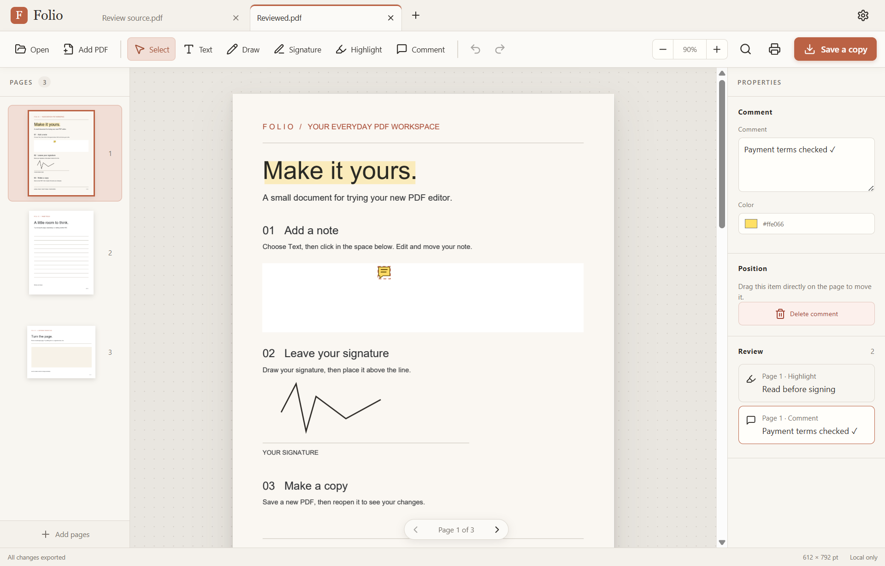

# Folio

Your everyday PDF workspace. A local Windows desktop PDF editor built with Rust,
Tauri and native PDFium. No AI, account, cloud upload or subscription.



## Get Folio

Download the Windows portable ZIP from [Releases](https://github.com/willherr72/folio/releases).
Extract it and open **Folio.exe**. Keep the resources folder beside the executable.
Microsoft Edge WebView2 Runtime is required.

The latest qualified combined local development package is **0.39.0-dev.1**.
This is not a published release. The [quality checklist](docs/product-quality-loop.md) records
verification scopes and remaining limitations.

The combined package includes **Folio.exe** for the desktop editor and
**folio-cli.exe** for command-line and local MCP automation. Both use the adjacent
`resources` folder. The [automation guide](docs/automation.md) covers inspection,
validated existing-text/paragraph edits, form filling, preview/apply/save and MCP
setup. Automation reads saved documents; it does not attach to unsaved desktop tabs.

The qualified executable is **artifacts/Folio-v0.39.0-dev.1/Folio.exe** in this checkout.
**Launch Folio.cmd** selects this package through its reviewed checkpoint. The archive is
**artifacts/Folio-v0.39.0-dev.1-windows-x64.zip**, with an adjacent SHA-256 checksum.
The previous accepted 0.36 and unqualified 0.37/0.38 candidates remain preserved,
with their original evidence. Version 0.39 combines the reviewed 64 MiB decoded
source cache and OCR review readiness correction, preserving all 100 Undo/Redo
states. The [sealed checkpoint](artifacts/portable-039-20261110/checkpoint.json)
and local launcher manifest record acceptance. Repository status notes were updated
after sealing; documentation inside the unchanged ZIP remains its candidate-time snapshot.
This package does not replace a running editor.

Supported workflows include existing-text and uniform/mixed paragraph editing,
images, form filling and common form authoring, page organization, comments, OCR,
password-protected documents and recovery. PDF compatibility remains conditional:
Folio validates supported edits and refuses changes it cannot safely preserve.
See the [quality checklist](docs/product-quality-loop.md) for tested workflows and
remaining gaps; feature breadth is not an Adobe/Foxit parity claim.

Supported tagged-document workflows now retain source structure, form answers,
navigation and page-copy ownership through composition, added content, saving
and recovery. Native comments and conservatively retained highlights are
preserved where supported; they are not universally editable drawing objects.
Supported composition preserves ordinary document Info and XMP, including custom
properties, while removing recognized conformance claims. Document properties can
be inspected, edited or explicitly removed from the desktop draft. Malformed or
unsupported metadata is refused before publication. General producer compatibility,
sustained memory usage, physical printing and accessibility verification remain
open quality work.

## Everyday editing

Use the desktop executable from the current package for the workflows below.
Earlier per-feature development builds and their evidence remain documented in the
[quality checklist](docs/product-quality-loop.md); they are historical checkpoints,
not separate applications needed for individual features.

- **Existing PDF text:** edit eligible text and paragraphs while preserving original
  fonts, supported clipping and tagged content. Supported Latin text includes
  accented characters in verified standard and embedded font repertoires. Saved
  paragraphs remain editable when equivalent older and current Folio font
  resources coexist. Choose an explicit substitute when
  a subset lacks a needed letter. Saved embedded-font text can be edited again
  without reimporting the font; fit and neighboring-content checks still apply.
  Eligible paragraphs retain their original first-line position while fitting,
  including supported clipped text and hollow callouts. Repeated editing reuses
  successful text discovery while every edit still receives native validation.
  A replacement and chosen font carry from Edit text into Edit paragraph, with
  one local Undo/Redo action; failed preparation keeps the original input open.
  [Supported workflows and limits](docs/existing-text-editing.md).
- **Local automation:** inspect, preview, apply and save page or nested text and
  paragraphs, including explicit font choices and consecutive edits. Supported
  forms can be inspected and filled. CLI and MCP use the same native preservation
  checks as the desktop. [Automation guide](docs/automation.md).
- **Document properties:** inspect source Info/XMP presence and edit Title, Author,
  Subject and Keywords from Save options. Changes support Undo/Redo and recovery.
  Explicit removal clears document-level Info/XMP; it does not remove page/object
  metadata, attachments, comments or visible text.
- **Existing forms:** fill answers, edit field properties, adjust supported borders
  and backgrounds, or remove a field with its linked widgets. Verified source
  artwork and resource bindings are retained; ambiguous appearances are refused.

- **Saved-note page controls:** in Select
  mode, click a saved note, drag its outline and release to move it. Double-click
  or press Enter to open its editor. Arrow keys adjust a pending position by one
  point (Shift: ten); Enter applies and Escape cancels. The original icon remains
  visible until the move is committed. Each move is undoable, including shared
  page copies. Hidden notes stay in Review without invisible page targets;
  locked/read-only notes can be read but cannot be moved. Page targets account for
  intrinsic rotation and icons marked “do not rotate.” Whole-page rotation now
  uses native rendering for the page and thumbnails; rotated note icons and their
  targets agree with the saved PDF. The original annotation flags are preserved.


- **Existing sticky notes:** Review
  includes saved PDF sticky notes while preserving their original icons, authors,
  subjects, dates and popups. Select a note to edit plain text, move it with
  **Left / Top** fields, change a plain icon's color, or **Delete comment**.
  Position fields follow the displayed page rotation. Each applied change or
  deletion is undoable and survives save/reopen and recovery. Custom appearance
  colors stay unchanged; locked, hidden, rich-text, reply/state and signed-document
  comments remain read-only. Parent notes with replies cannot be deleted yet.
  PDF annotation permissions still apply. Older recovery drafts retain their
  original overlay ownership so edited or deleted notes do not return.
  Rich-text/thread authoring remains a gap.

- **Reading history:** use **Back to
  previous view** and **Forward to next view** beside the page controls, or
  **Alt+Left / Alt+Right**, to return after bookmarks, page jumps, thumbnails,
  search results and review items. Each tab remembers up to100 views per direction,
  including reading position and zoom. Scrolling does not fill the history. Deleted
  pages are skipped; this history is separate from editing undo and resets after
  recovery. Toolbar zoom keeps the current reading point centered. Document actions
  and editing tools use separate rows so primary controls remain visible.

- **Protected PDFs:** enter the PDF password when prompted;
  an incorrect password can be retried or cancelled. Viewing, Find and annotation
  review remain available. Controls follow the document's copying, editing, annotation,
  form, page-assembly and printing permissions. **Unlock editing** accepts the owner
  password and is undoable. Saved copies retain the original passwords and permissions,
  including after text edits, form filling and crash recovery. Low-quality printing is
  limited to 150 dpi. Combining PDFs with different protection is refused before adding
  them through ordinary Save; save separate copies. **Save options → Security settings…**
  can create a copy with new AES-256 passwords and permissions or remove password
  protection after owner authorization for every protected input. Certificate
  encryption and signed-document rewriting are not supported.
- **Existing PDF forms:** saved copies retain AcroForm fields,
  values, appearances and shared widgets when pages are reordered, duplicated or
  extracted. Choose **Fill forms** to fill text, checkboxes, radio buttons and choice
  lists on the current page, with a PDF preview and one-step undo for each applied
  field. Shared fields update together; edits survive recovery and remain interactive
  after saving. Editable combo boxes support listed options or custom text.
  Click an outlined field in the preview to
  select it and focus its value control. Dirty drafts stay protected until Apply
  or Reset; hidden fields have no page target, and visible read-only fields explain
  their restriction. The preview also offers up to 3× fit-width zoom and
  **Show selected field** to bring its outline into view without changing a draft.
  Calculations/validation scripts and PDF actions are not executed during filling.
  Read-only, rich-text/file-selection and signed/XFA fields are not fillable yet.
  Ambiguous combinations
  involving field names/actions, signed forms and XFA report an error before saving.
  Supported existing-text and paragraph edits preserve connected fields shared
  across pages. Native preservation checks still govern each edit. Signed/XFA forms
  cannot yet use the export-based printing path.
- **Bookmarks:** switch the sidebar to **Bookmarks** to follow
  a PDF's outline. Add a bookmark or child, edit its title/destination, move sibling
  branches, or delete a branch with undo/redo. Internal targets stay attached to
  pages through reordering and text edits. Save and extraction preserve hierarchy,
  title styling and destination views; recovery keeps bookmarks without the original
  PDF. External actions are preserved in saved PDFs and are not executed in Folio.
  Unreadable bookmark metadata is reported and requires explicit discard before
  saving. Click the page counter to jump directly to a page.
- **Images to PDF:** combine ordered PNG/JPEG files into a new
  PDF, or use **Insert image pages…** in Page actions. Choose paper size, automatic
  or fixed orientation and margins. Images fit without cropping; photo orientation
  is honored and transparency uses white. Supports up to 32 files per import,
  64 MiB/32 million pixels per image and 80 million pixels total. Insertion supports
  undo/redo; generated pages survive recovery without the image files. Conversion
  uses decoded RGB samples; print-oriented ICC color management is not included.
- **Blank pages:** **New PDF** starts an unsaved Letter, A4 or
  Legal document in portrait or landscape. **Insert blank page…** in Page actions
  inserts before/after the current page or at the end, with one-step undo/redo.
- **Replace page content:** in Page actions, choose another
  PDF and its page, preview, then Apply. Only the selected duplicate changes;
  existing page size, crop, rotation, forms, comments, links and added edits stay
  in place. Undo/redo and workspace recovery retain the replacement. Incoming
  annotations are not imported. Protected incoming PDFs and some complex content
  are not yet supported; an unsuccessful preview leaves the workspace unchanged.
- **Documents:** Open adds a PDF in a new top tab. Each document retains its edits,
  undo/redo history, selected page, zoom and scroll position when you switch tabs.
- **Edit existing text:** choose **Edit text**, click an outlined run, change **Replacement text**, and apply. Verified single runs use standard Helvetica, Times and Courier or embedded TrueType fonts, including subsets. Rotation, scaling and explicit spacing are supported within the preservation checks. Longer replacements can use available space. Eligible ordinary runs and supported nested-form occurrences can choose an explicit substitute font when a subset lacks a letter. Choose **Edit together…** to explicitly select and verify 2–8 compatible adjacent pieces as one replacement. Supported text-only nested forms can edit one selected occurrence without changing shared copies. Try **examples/Edit one shared occurrence.pdf**. [Support details](docs/existing-text-editing.md).
- **Edit paragraphs:** from an existing text piece choose **Edit paragraph…**, select the paragraph’s pieces on the page or in the list, and check the selection. Supported paragraphs can contain mixed fonts, sizes and colors: select words to format them, or place the caret to format new text. Draft undo/redo and explicit font substitution are available. Zoom and compare Original/Edited before applying. Added text, ink, highlights and comments appear in both previews and remain editable. Adjust the area and position, preview, then Apply. Saved supported paragraphs retain their text, styles and line breaks for re-editing. Overflow, missing original subset glyphs and unsafe overlap with source text/graphics keep the draft and leave the source unchanged. See [existing text editing](docs/existing-text-editing.md) for limits and the earlier uniform editor.
  **Font size (pt)** and **Reset font size** apply to selected text or its typing
  format. Explicit sizes from 1–300 pt reflow within the chosen area. Preview must
  succeed before Apply; overflow retains the draft. **Paragraph alignment** offers
  Left, Center, Right and Justify. Regular source alignment is inferred when it can
  be verified; ambiguous selections default to Left. Review the preview before applying.
  **Line spacing (× font size)** accepts 0.6–3; 1 is single spacing and 2 is
  double spacing. Regular spacing is estimated from the selected lines; otherwise
  it starts at 1.2. **Reset line spacing** restores that initial value. Widely
  spaced lines may need **Adjust selection** to include the whole paragraph.
- **Text:** choose Text and click a page. The Content field selects the placeholder
  immediately, so typing replaces it. Choose a font and style, adjust size/color, and drag the note to move it. **More fonts…** searches installed fonts or imports a local TTF/OTF. Preview your text, then choose **Apply font**. Supported fonts are embedded so recipients do not need to install them. [Font support](docs/font-support-roadmap.md).
- **Shaped text (v0.10.0):** enable **Shaped text** in Properties, enter a single line, then choose an exact custom font with **More fonts…**. Native previews support tested ligatures, combining marks, Arabic joining and Indic samples. Mixed direction and RTL word separators remain unsupported. [Scope and verification](docs/shaped-editor-integration.md).
- **Select and copy:** drag across embedded PDF text in Select mode, then press
  **Ctrl+C** to copy it, including spaces and line breaks. Scanned pages without
  embedded text need recognition first.
- **Recognize text:** recognize scanned pages locally in
  English, French or Spanish. Choose the current page, a range or all pages; review
  word boxes, correct uncertain text, then **Apply searchable text**. Corrections
  change search and copying; scanned lettering stays unchanged. Existing selectable
  text is retained. Copies of the same source page update together in one undo step.
  Saved Folio OCR can be reopened for correction without recognition again.
  [Workflow, limits and development setup](docs/local-ocr.md).
- **Draw:** write or sketch directly on any page. Choose pen color and width in
  Properties. Each stroke is one undo step; Select lets you move or delete it.
- **Signature:** draw or choose a saved signature. Give drawings a name to keep them in
  the local library, with rename and delete controls. Move over a page to preview,
  click to place, or press **Escape** to cancel. Properties adjusts the placed ink's
  width while keeping its proportions.
- **Highlight:** choose Highlight and drag across embedded text, including multiple
  lines. Select highlights on the page or in Review to change their color or note.
- **Comment:** click a page to place a note and start typing. Review lists highlights
  and comments throughout the document; select one to jump to its anchor. Notes can
  be edited, moved or deleted. These edits support undo/redo in each tab.
- **Review persistence:** highlights and comments save as standard PDF annotations
  and reopen with editing controls. Supported annotations from other readers are
  imported too. Unsupported types, locked notes, and notes with special zoom/rotation
  or visibility flags remain in the source content with their original appearance.
- **Pages:** drag thumbnails by their handles to reorder. A line shows the drop
  position. Page properties also provide move, rotate, duplicate and delete.
  **Add PDF** appends pages from another PDF to the active document. In development
  builds, **Extract pages…** in Save options or Page actions saves the current page,
  all pages, or ranges as a separate editable PDF with your current edits. Extraction
  keeps the original workspace and its unsaved status unchanged.
- **Reading:** scroll continuously between pages. Hold **Ctrl** while scrolling
  to zoom around the pointer.
- **Settings:** choose Light, Dark or System theme, continuous or single-page
  view, default zoom, pen color and pen width. Preferences are remembered.
- **Search:** Ctrl+F finds words or phrases in embedded PDF text and your added text.
  Enter/Shift+Enter move through highlighted results; Escape closes search. Each tab remembers its search.
- **Print:** Ctrl+P prints the current edits. Choose all pages, the current page, or
  a range, then fit/actual size and orientation. The Windows dialog selects the printer,
  paper and copies. Printing does not mark your edits saved.
- **Recovery:** local checkpoints preserve native tabs, edits, page arrangement,
  zoom and scroll after an unexpected exit. On restart, restore or discard the workspace.
  Source, font and image snapshots allow recovery even if the original files moved. Undo history starts fresh.
- **Images:** choose **Image** to insert a PNG or JPEG on the selected page. Click to
  place it, or press Enter at the default position. Esc cancels. Drag the image or
  its corner handles; use Properties for exact position, size and quarter-turn
  rotation. Proportions start locked. Arrow keys move a selected image or resize a
  focused handle; Shift makes larger steps. Each completed change can be undone.
- **Content removal (development builds):** choose **Remove content…**, mark areas,
  and preview text, graphic and image removal together. Review every affected page
  and any disclosed expansion or omitted document information before applying.
  Other copies elsewhere in the PDF remain. Apply supports Undo/Redo; **Save a copy**
  writes the result. Unsupported PDFs or edits that disturb retained content are
  refused. **Remove text…** remains available for text-only removal. This workflow
  is new in 0.31 development builds; older packages remain available.
- **Save a copy:** save a portable PDF with editable text, images, drawings and signatures,
  alongside highlights and comments. Reopening in Folio restores their controls,
  including on rotated or reorganized pages. No original files or sidecars are needed.
  The arrow beside Save offers **Flatten text, images, and ink**, which turns those additions
  into page content. Highlights and comments remain annotations. A flattened export
  does not mark your editable workspace saved.

Start with **examples/Welcome to Folio.pdf**. Ctrl+Z/Ctrl+Shift+Z undo and redo;
Ctrl+O opens a PDF in a new tab and Ctrl+S saves a copy of the active document.
Ctrl+Tab/Ctrl+Shift+Tab switch tabs; Ctrl+W closes the active tab. Closing an
unsaved tab asks for confirmation. Closing Folio checks every tab for unsaved
changes, including inactive tabs. Cancelling a close leaves your documents open.

Dark mode changes the interface; PDF pages retain their original colors.

## Prototype boundaries

- Existing-text editing requires verified encoding and glyph mappings. Same-font single runs can preserve explicit spacing and affine transforms; verified adjacent groups and selected nested-form occurrences have narrower support described in docs/existing-text-editing.md. Ambiguous mappings and shaped existing text remain unsupported. Explicitly spaced text requires a uniquely mapped operator; font substitution remains subject to the native context and placement checks.
- Drawn signatures are visual marks, not certificate-based digital signatures.
- Editable additions use standard PDF annotations with self-contained appearances and
  versioned Folio metadata. Other readers can display them; edits made by another
  reader may prevent Folio from restoring handles. Unsupported or changed metadata
  leaves the annotation in the PDF with its native appearance. See
  [editable PDF format](docs/editable-pdf-format.md).
- Added text supports twelve standard PDF faces and installed/imported static TrueType-outline fonts with editable embedding permissions. Legacy boxes support covered Latin, Greek, Cyrillic and selected punctuation/symbols. Opt-in shaped boxes add tested ligatures, combining marks, Arabic joining and Indic samples. CFF, variable/color fonts and collections remain unsupported. Unsupported text produces a clear error.
- Redaction is not implemented. Common form creation, existing form filling and
  password-protected PDFs are supported within the scope above. Supported existing
  fields expose position, size, appearance and property controls; labeled radio groups
  can be created. Calculations and arbitrary custom field fonts remain unsupported.
- Printing uses bounded raster images (up to 2400 pixels wide), so it does not preserve
  selectable/vector text in virtual-printer output. Save a copy preserves source vectors.
- Opened PDFs are held as immutable source bytes, with a 512 MiB per-file limit.
- Windows x64 is the tested target. Foxit performance parity has not been established.

## Local signature library

Named signatures are stored in this application's local WebView profile. There is no
account or upload. The library holds up to 30 signatures and reports storage errors.
Deleting a library entry does not remove signatures already placed in a document.
Visual signatures do not provide certificate verification.

## Local recovery data

Current source builds retain PDF versions in independent compressed blocks and can
spill history data to Windows-account-encrypted temporary files. This preserves the
100-action editing history. The backing is released when its retained source closes
or the application exits, and is separate from durable recovery checkpoints. The
0.33 portable predates this storage change.

Folio checkpoints after one second of inactivity, or within five seconds during continuous
editing. A crash can lose changes since the last successful checkpoint. Confirmed normal
closing discards recovery data; cancelling a close keeps your work. Source files are never
automatically overwritten. Recovery is separate from saving a PDF with editable handles.

Data lives under the application local-data folder (normally
%LOCALAPPDATA%/com.folio.desktop/recovery). Set **FOLIO_DATA_DIR** to choose a different
local data directory. A second instance using the same directory can continue with
recovery disabled; it cannot overwrite the first instance's checkpoints. Failed checkpoints
show a visible warning. Checkpoints are limited to 32 MiB of edit/view metadata.

Development builds protect recovery workspace, source and font payloads with Windows
account encryption (DPAPI), including temporary writes. Restore decrypts in memory.
These recovery files normally require the same Windows account/profile; copying the
folder to another account is not a recovery backup. Account/profile loss may make
recovery unavailable. Save a PDF copy for a portable document.

Readable legacy checkpoints are upgraded automatically. Abandoned recovery temporary
files are removed; damaged generations can fall back to a valid earlier checkpoint.
Migration never rewrites the original PDFs. Filesystem access failures can prevent
cleanup of old files, and this does not securely erase previously written disk sectors
or protect against software running under your Windows account. Recovery retains
authenticated PDF protection without storing your password.
A restored owner-unlocked session keeps that access within the same Windows account;
saved PDFs still require the original credentials and retain their original permissions.


## Roadmap

[GitHub Issues](https://github.com/willherr72/folio/issues) is the central backlog.
Milestones group v0.4 recovery/search/printing, v0.5 reusable signatures/highlights,
v0.6 editable persistence/extensive testing, v0.6.1 performance fixes, and v0.7 existing-word editing.
Physical 8 GB hardware validation remains tracked in [issue #10](https://github.com/willherr72/folio/issues/10).

## Build from source

Install Node.js, stable Rust with the MSVC toolchain, Visual Studio 2022 C++ Build
Tools with the Windows SDK, CMake 3.21 or newer, and Microsoft Edge WebView2 Runtime.
The native JPEG component builds its pinned vendored source offline through CMake;
it does not download a codec during the application build. Set `CMAKE` to a CMake
executable path if it is not on `PATH`.

First build and install the corrected PDFium dependency using
[the pinned source recipe](docs/building-pdfium.md), including its additional
Python/Ninja and exact MSVC prerequisites.

In PowerShell:

```powershell
npm ci
npm run setup:ocr
powershell -NoProfile -ExecutionPolicy Bypass -File scripts/fetch-pdfium.ps1
npm run tauri dev
```

Build a release executable and portable ZIP:

```powershell
powershell -NoProfile -ExecutionPolicy Bypass -File scripts/build-portable.ps1
```

`fetch-pdfium.ps1` verifies
that dependency's DLL, patch and source-lock fingerprints; it refuses to replace
it with the upstream binary that loses inherited form text state.
All PDF processing afterward happens locally.
The OCR setup also verifies pinned local worker/core files and downloads checksum-checked
English, French and Spanish models. Normal dev/build verifies these assets offline.
Scanned-PDF review, correction and Apply use these bundled assets without network
access. See [local OCR development](docs/local-ocr.md) for the supported workflow.

## Verification

```powershell
powershell -NoProfile -ExecutionPolicy Bypass -File scripts/verify.ps1
```

Browser checks: install Playwright Chromium, start the Vite server, then run
**scripts/smoke-ui.mjs** and **scripts/smoke-upgrades.mjs** with Node.
Explicit browser demo mode uses generated pages and exports a JSON edit plan.
Real PDF editing runs in the desktop app. The [v0.9.1 reader-selection checks](docs/verification-v0.9.1.md)
cover shared character boxes, exact copying and highlights, and record the
packaged desktop automation limitation.

The native smoke opens a real PDF through Windows dialogs, edits it, draws,
drags thumbnails, checks both close-confirmation decisions, saves and reopens.
Its launcher uses an isolated test profile. See [v0.9.0 text-edit verification](docs/verification-v0.9.0.md), [v0.6.1 performance verification](docs/performance-v0.6.1.md), the [compatibility corpus](docs/corpus/README.md), and [earlier verification notes](docs/verification.md).

## Internals and license

React keeps an undoable edit plan. Rust owns source documents and serializes
PDFium work on a dedicated thread. Nearby pages use cached native renders and
embedded text geometry.
Current source storage targets 64 MiB of cached raw bytes and at most 64 MiB of
resident encoded payloads. A single most-recent source may exceed the raw-cache
target, up to the existing 512 MiB source limit. Caller leases, active operations,
native renderer allocations and WebView memory are outside these cache budgets.
Export copies PDF pages and adds text, vector ink and standard review annotations.

MIT for Folio's original code. Dependencies retain their own licenses; see
[third-party notices](THIRD_PARTY_NOTICES.md). Portable releases include PDFium
licenses and collected dependency notices.

[Changelog](CHANGELOG.md)

## Compatibility and performance corpus

The [corpus guide](docs/corpus/README.md) records fixture provenance, reproducible
commands and measured Windows baselines. Small synthetic PDFs are versioned; large
scans and 300-page fixtures are generated locally. No private documents are included.

The [complex-text development gate](docs/shaped-text-interop.md) records native
shaping and PDF serialization experiments for issue #14. The `shaped-text` Cargo feature is included in default application builds starting
with v0.10.0. The [editor integration](docs/shaped-editor-integration.md) describes
the supported subset and its reader-copy and selection checks.

The [native semantic PDF verification](docs/semantic-native-verification.md)
passes exact Unicode in three readers for 32 unmixed sample/rotation cases.
Mixed-direction text remains refused, and MuPDF cluster selection still differs.
[Shaping resource checks](docs/shaping-resource-limits.md) document the pinned
completion-status patch and bounded outline traversal. The released editor offers the tested subset through opt-in shaped text boxes.

[Long-text verification](docs/semantic-long-native-verification.md) extends this
experiment through exact character-definition reuse, including a 4,096-scalar
fixture. It also records an RTL word-order failure that was hidden by repeated
words. RTL separators and joiners now produce an explicit refusal; they still
need a proven reader-order strategy before editor integration.

[Font-resource boundary experiments](docs/semantic-font-banks.md) record why
splitting definitions across fonts failed to remove the original 255-definition gate:
PDFium can reorder copied text on rotated pages, and whole-line ActualText loses
selection geometry. These negative probes remain outside the editor.

The [rotated reader-order investigation](docs/reader-order-workaround.md) reduces
the defect to ordinary same-font text and documents Folio's conservative
correction for eligible simple-text pages, including explicit fallback cases.

Starting with v0.10.1, [one wide semantic font](docs/issue14-wide-semantic-probe.md)
handles more than 255 definitions while keeping the 4,096-scalar input bound.
Shaped Content uses whole-grapheme Backspace/Delete and preserves native undo.
[Issue #14 acceptance status](docs/issue14-status.md) records the remaining gates.

Try the [positioned text practice PDF](examples/Positioned%20text%20demo.pdf) with **Edit text** to test rotation, skew and spacing. See [issue #15 status](docs/issue15-status.md) for the current scope.

The [text-area layout checkpoint](docs/text-area-layout-checkpoint.md) covers native wrapping and preview/PDF evidence for #16. [Text-area editing and persistence](docs/text-area-persistence.md) now supports drawing areas, choosing fonts, corner/keyboard resizing and layout properties, alongside editable PDF saves and crash recovery. Choose **Text area**, drag a box, select a font and type in **Content**. These features are included in the current local development package; the linked documents retain their historical checkpoint evidence.

The [October restart comparison](docs/word-copy-comparison.md) reproduces the external-copy differences
and measures equivalent Microsoft Word exports. The approved [copying contract](docs/text-area-copy-policy.md)
requires exact text within Folio and permits specified whitespace differences in external readers.
All seven saved native-area exports meet that reader check. Text areas currently support the bounded Latin/LTR layout scope; broader script and release acceptance work remains open.
